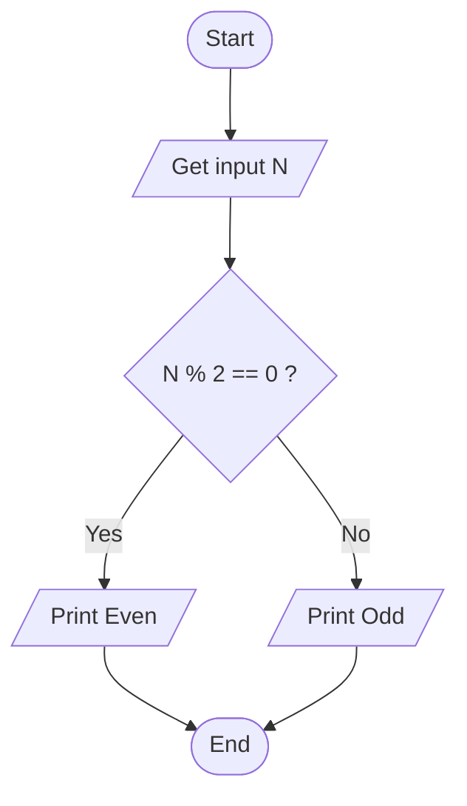
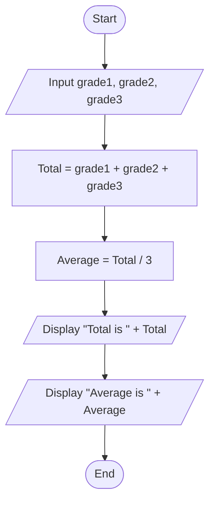
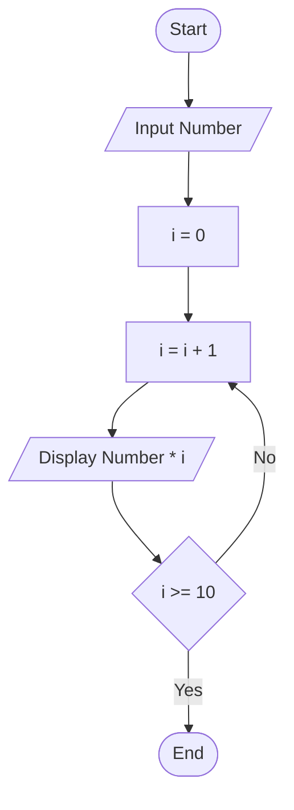
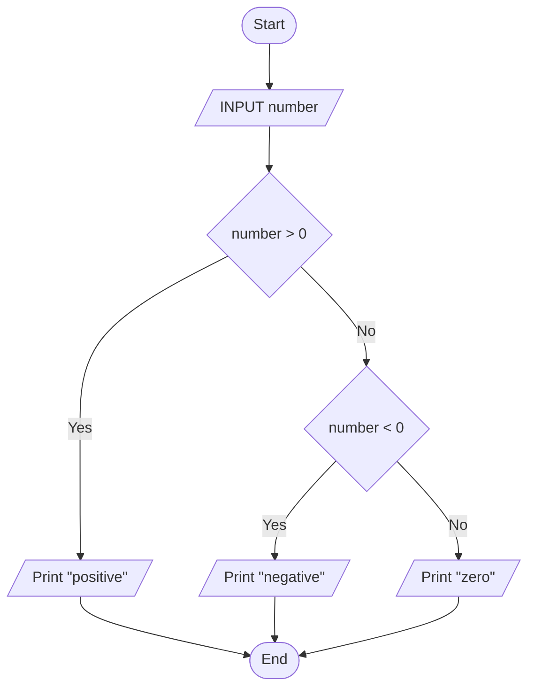
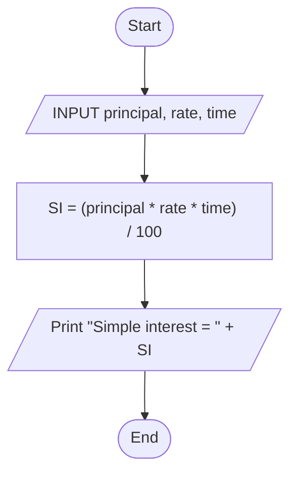
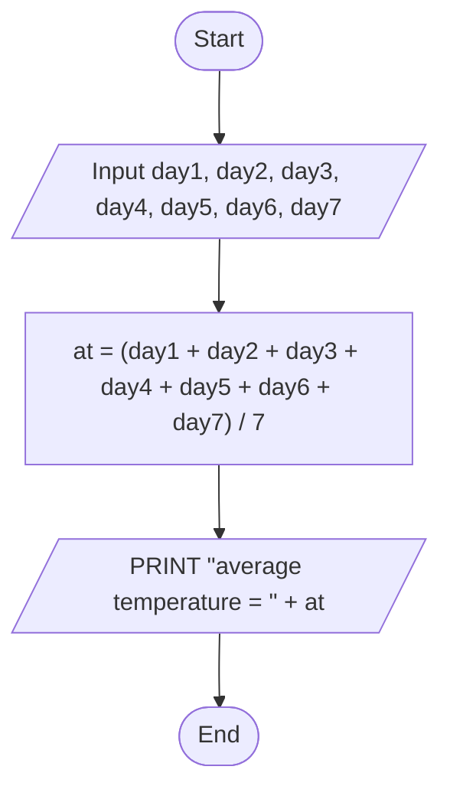
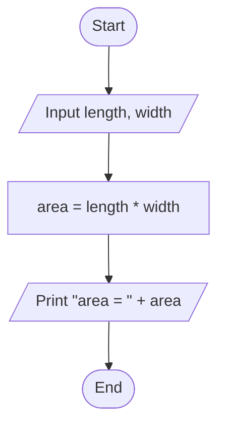
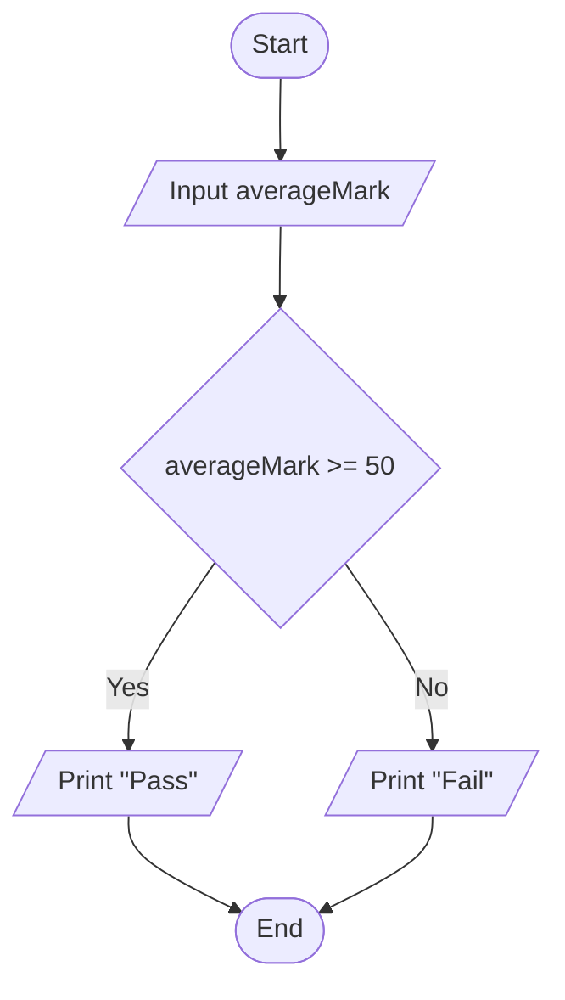
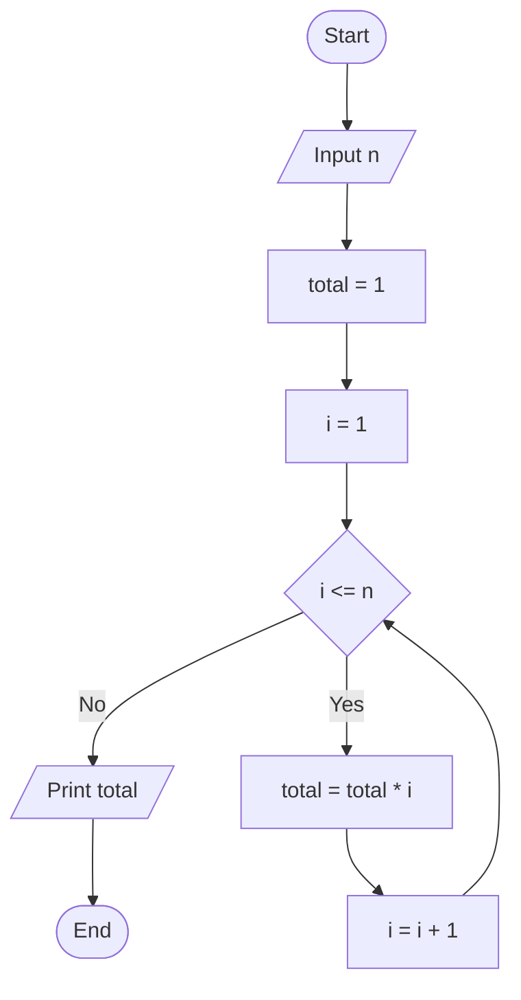
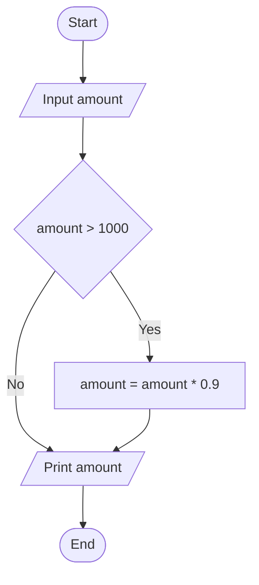

# algorithm-flowchart-workshop
An Algo and flowchart workshop

## 1. Check Even or Odd Number

Design an algorithm and flowchart that take a number as input and determine whether it is **even or odd**.

### ✔ Pseudocode

```text
START
    INPUT number
    IF number % 2 == 0 THEN
        PRINT Even
    ELSE
        PRINT Odd
    ENDIF
END
```

### ✔ Flowchart



---

## 2. Calculate Total and Average Marks

Write the algorithm and draw the flowchart for a program that inputs **marks for 3 subjects**, calculates the **total and average**, and displays both.

### ✔ Pseudocode

```text
Start
    INPUT grade1, grade2, grade3
    Total = grade1+grade2+grade3
    Average = Total/3
    DISPLAY "Total is " + Total
    DISPLAY "Average is " + Average
END
```

### ✔ Flowchart



---

## 3. Display Multiplication Table

Create an algorithm and flowchart that input a number and display its **multiplication table from 1 to 10** using a loop.

### ✔ Pseudocode

```text
Start
Input Number
FOR i = 1 TO 10
Display Number * i
ENDFOR
END
```

### ✔ Flowchart



---

## 4. Positive, Negative, or Zero Check

Write the algorithm and flowchart to input a number and display whether it is **positive, negative, or zero**.

### ✔ Pseudocode

```text
START
    INPUT number
    IF Number > 0      
        Display "positive"
    ELSE IF  Number < 0
        Display "negative"
    Else
        Display "zero"
    ENDIF
End
```

### ✔ Flowchart



---

## 5. Simple Interest Calculator

Create an algorithm and flowchart for a program that calculates simple interest using **SI = (P × R × T) / 100**. P = principal (the original amount), R = rate of interest (percent per year), T = time in years.

### ✔ Pseudocode

```text
START
    INPUT principal, rate, time
        SI = (principal*rate*time) / 100
   PRINT "simple interest = " + SI 
END
```

### ✔ Flowchart



---

## 6. Average Temperature Calculation

Write the algorithm and draw the flowchart for a program that takes the **temperature of 7 days**, finds the **average temperature**, and displays it.

### ✔ Pseudocode

```text
START
    INPUT day1, day2, day3, day4, day5, day6, day7
    at = (day1 + day2 + day3 + day4 + day5 + day6 + day7) / 7
    PRINT "average temperature = " + at
END
```

### ✔ Flowchart



---

## 7. Calculate Area of a Rectangle

Create an algorithm and flowchart to input **length and width**, calculate the area (**Area = Length × Width**), and display the result.

### ✔ Pseudocode

```text
START
    INPUT length, width
    area = length * width
    PRINT "area = " + area 
END
```

### ✔ Flowchart



---

## 8. Determine Pass or Fail

Write the algorithm and draw the flowchart for a program that takes a student's average marks and displays **"Pass"** if average ≥ 50, otherwise **"Fail"**.

### ✔ Pseudocode

```text
START
    INPUT averageMark
    IF  averageMark>=50
        PRINT "Pass"
    Else
        PRINT "Fail"
    ENDIF
END
```

### ✔ Flowchart



---

## 9. Calculate Factorial of a Number

Write the algorithm and draw the flowchart that input a number and calculate its **factorial** using a loop. (5! = 5 × 4 × 3 × 2 × 1)

### ✔ Pseudocode

```text
START
    INPUT n
    total = 1
    FOR i = 1 TO n
        total = total * i
    ENDFOR
    PRINT total
END
```

### ✔ Flowchart



---

## 10. Calculate Discount on Purchase

Write the algorithm and draw the flowchart for a program that inputs the purchase amount and gives a **10% discount** if the amount is **greater than 1000**.

### ✔ Pseudocode

```text
START
    INPUT amount
    IF amount > 1000
        amount = amount * 0.9
        PRINT amount
    Else
        PRINT amount
    ENDIF
END
```

### ✔ Flowchart



---
